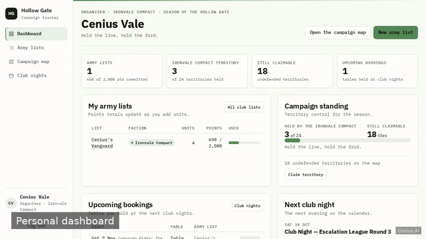
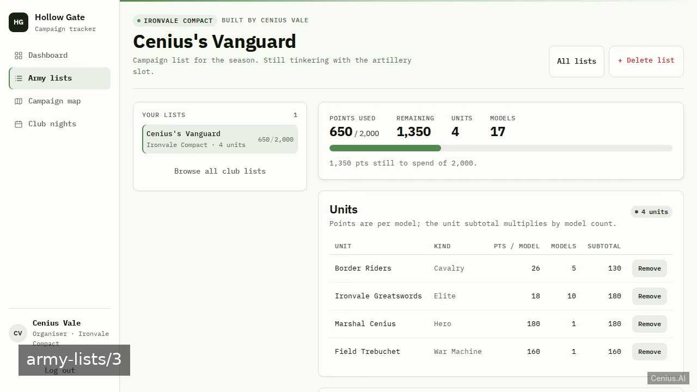
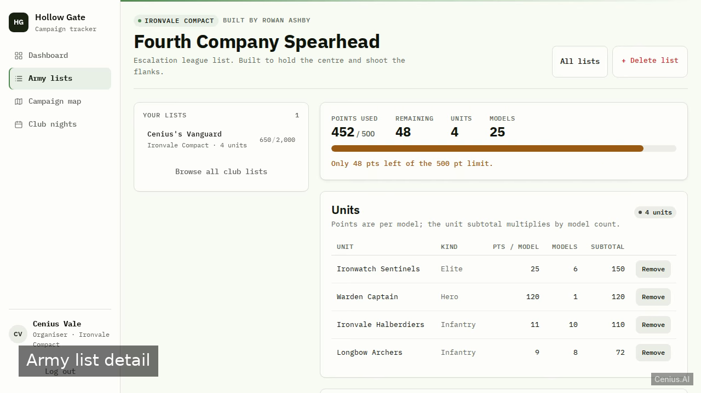

# Tabletop Wargames Club Campaign — V book monitoring dashboard reference implementation

**Tabletop Wargames Club Campaign** is Apache-2.0-licensed and fully open-source: a book monitoring dashboard written in V that you can run, modify, and ship commercially without restrictions. A server-rendered club management web app built on Starlette + Uvicorn with SQLite persistence, where members register their own accounts, build faction army lists scored in points, claim undefended territories on a c…. Grab Tabletop Wargames Club Campaign from this repo and self-host it, or [remix it on cenius.ai](https://cenius.ai/marketplace/p/tabletop-wargames-club-campaign?ref=gh&utm_campaign=tabletop-wargames-club-campaign-vlang) — the platform grants full rebrand rights on every change.


[](LICENSE)  [](https://cenius.ai)

[](https://cenius.ai/marketplace/p/tabletop-wargames-club-campaign?ref=gh&utm_campaign=tabletop-wargames-club-campaign-vlang)

> **▶ [Open & edit in cenius.ai](https://cenius.ai/marketplace/p/tabletop-wargames-club-campaign?ref=gh&utm_campaign=tabletop-wargames-club-campaign-vlang)** — one click to an editable workspace: describe changes in plain English, get an instant preview, one-click deploy and host. Modifications made on the platform come with full rebrand & relicense rights.

_Local clone? See [Quick start](#quick-start) below. cenius.ai is the zero-setup path._

## Demo



▶ **[Video walkthrough](https://cenius.ai/marketplace/p/tabletop-wargames-club-campaign?ref=gh&utm_campaign=tabletop-wargames-club-campaign-vlang)** — see the app in action on the cenius.ai project page · [MP4 file](.github/media/demo.mp4)

## Screenshots

  

## Features

- Member accounts, login and roles
- Army lists by faction with points
- Campaign map territory control
- Table booking for club nights
- Personal dashboard
- Seed data and demo bootstrap

## Quick start

```bash
./install.sh   # installs dependencies + seeds demo data
```

See [`INSTALL.md`](INSTALL.md) for full setup and usage instructions.

## Architecture

Everything runs out of the box: a V codebase (48 files). Run `./install.sh` once to install packages and populate demo data — the app is ready to use immediately after. Top-level layout: `app/`, `scripts/`, `tests/`. Full setup details: [`INSTALL.md`](INSTALL.md).

## Usage guide

Sign in at `/login`. The demo panel on the login card lists the three seeded
accounts and offers one-click sign-in.

- `cenius@cenius.ai` / `cenius` — organiser
- `rowan@ironvale.club` / `wargames` — member (Ironvale Compact)
- `marek@ashenchoir.club` / `wargames` — member (Ashen Choir)

### Dashboard (`/`)

The home screen answers "where do I stand?" in one view:

- a greeting showing your display name, role and faction motto;
- four KPI tiles: army lists and points committed, territories held by your
  faction (of 24), territories still claimable, and upcoming tables;
- **My army lists** with owner-visible points progress bars;
- **Campaign standing** for your faction with a held/24 meter and a claim link;
- **Upcoming bookings** with a cancel button on each row;
- **Next club night** with the free-table count and a link to that night;
- for organisers only, **club totals**: members, army lists, undefended
  territories and bookings ahead.

A brand-new member gets invitations instead of blank panels ("Create your first
army list", "Book a table").

### Army lists (`/army-lists`)

1. Pick a faction, a name and a points limit in the **New army list** form.
2. The left pane lists every club list grouped by faction with owner, unit count
   and `total / limit` points. Your own lists are highlighted.
3. Open a list to see its running total, remaining points, a progress bar that
   turns amber near the limit, and the units table.

On your own list:

_Full guide: [`USAGE.md`](USAGE.md)_

## FAQ

### How do I run Tabletop Wargames Club Campaign on my own server?

`git clone` + `./install.sh` gets you a running instance — the install script provisions dependencies and demo data. Full steps live in [`INSTALL.md`](INSTALL.md); nothing external is needed to try it.

### How is Tabletop Wargames Club Campaign built technically?

Tabletop Wargames Club Campaign runs on V. This repo holds the full production source: you can inspect every part of it before deploying. Highlights include member accounts, login and roles.

### Is there a no-code way to modify Tabletop Wargames Club Campaign?

The easiest route: [visit the project on cenius.ai](https://cenius.ai/marketplace/p/tabletop-wargames-club-campaign?ref=gh&utm_campaign=tabletop-wargames-club-campaign-vlang), tell the platform what to change, and collect the updated build. No source-editing needed.

### How do I make Tabletop Wargames Club Campaign my own brand?

Yes. You can edit the source directly under the MIT license, or [remix it on cenius.ai](https://cenius.ai/marketplace/p/tabletop-wargames-club-campaign?ref=gh&utm_campaign=tabletop-wargames-club-campaign-vlang) — the platform route grants full rebrand and relicense rights over your derivative.

### Is it OK to ship Tabletop Wargames Club Campaign as part of a product?

It is. Apache-2.0 licensing means you can build a product on it, sell it, or use it inside a company with no fees. Details: [LICENSE](LICENSE).

## License & rebranding

Released under the [Apache License 2.0](LICENSE) (© 2026 Cenius AI) — free for personal and commercial use. The Cenius name/logo are trademarks (see NOTICE).

**Need a customized version?** [Remix this app on cenius.ai](https://cenius.ai/marketplace/p/tabletop-wargames-club-campaign?ref=gh&utm_campaign=tabletop-wargames-club-campaign-vlang) — modifications made on the platform come with **full rebrand & relicense rights** over your derivative.

## Built with cenius.ai

This entire application — code, design, seeded demo data — was generated on **[cenius.ai](https://cenius.ai)** from a plain-English description.

- 🚀 [Build your own app on cenius.ai](https://cenius.ai)
- 🎛️ [Remix Tabletop Wargames Club Campaign on the marketplace](https://cenius.ai/marketplace/p/tabletop-wargames-club-campaign?ref=gh&utm_campaign=tabletop-wargames-club-campaign-vlang) — open it in a workspace, prompt for changes, and ship your own version.

More open-source apps: [the Cenius-ai catalog](https://github.com/Cenius-ai) · [showcase index](https://github.com/Cenius-ai/showcase)
